 

## About

I'm a Computer Science student at **John Jay College of Criminal Justice (CUNY)**, Class of 2028, with a minor in **Homeland Security**. I'm building a career in **cybersecurity** and I like projects where AI/ML meets real problems.

## Focus

- **Security**: learning how systems break so I can help keep them from breaking
- **AI / ML**: computer vision, LLM apps and automation
- **Building**: hackathons, web apps and small tools that ship

## Stack

## Projects

| Project | What it is |
|---|---|
| [**JanGustau17.github.io**](https://github.com/JanGustau17/JanGustau17.github.io) | My personal site |
| [**download_through_d_link**](https://github.com/JanGustau17/download_through_d_link) | Python tool |

<!-- Add or swap rows as you finish projects. Only link repos that are public. -->

## Contribution snake

<picture>
  <source media="(prefers-color-scheme: dark)" srcset="https://raw.githubusercontent.com/JanGustau17/JanGustau17/output/github-snake-dark.svg" />
  <source media="(prefers-color-scheme: light)" srcset="https://raw.githubusercontent.com/JanGustau17/JanGustau17/output/github-snake.svg" />
  
</picture>

